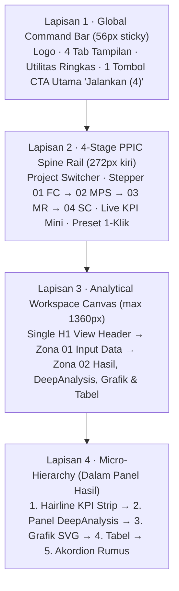

# Design Planning & UI/UX Blueprint — Ha Jodeya

| Atribut | Nilai |
| :--- | :--- |
| **Arah Estetika** | **Modern Precision PPIC Workbench** — bersih, terstruktur, berorientasi alur 4-tahap, bebas *visual clutter* |
| **Mode Tema** | **Light Analytical Paper** (Default) & **Precision Dark Slate** (`[data-theme='dark']`) |
| **Target Layar** | Desktop (`≥ 1120px`), Tablet (`768px–1119px`), Mobile (`< 768px` dengan Drawer), serta Cetak PDF (`@media print`) |
| **Pratinjau Interaktif** | Lihat pratinjau desain visual yang bisa diklik pada artefak [design_blueprint_preview.html](file:///home/antigravity/.gemini/jetski/brain/v1/default/jetski_remote_agents_3p_devbox/144ad6da-5065-4c95-aac2-f6a9e55b3acd/design_blueprint_preview.html) |

---

## 1. Filosofi Desain & Keunggulan Fokus 4 Metode

Memfokuskan aplikasi dari 16 modul menjadi **4 metode inti PPIC (`Forecasting → MPS → MRP → Scheduling`)** membuka peluang perancangan antarmuka yang jauh lebih modern, tenang, dan intuitif:

1. **Alur Mental Linear (*The 4-Stage PPIC Spine*):** Alih-alih menampilkan katalog 16 modul dengan 5 kategori dan kotak pencarian yang padat, sidebar kiri berubah menjadi **peta proses produksi 4 tahap bernomor (`01` → `02` → `03` → `04`)** yang saling terhubung secara visual. Pengguna selalu tahu di tahap mana mereka berada dan bagaimana data mengalir ke tahap berikutnya.
2. **Hierarki Visual 4-Lapisan yang Tegas:** Setiap layar memiliki urutan baca yang tak terbantahkan — *Global Command Chrome* → *View Header (Single `<h1>`)* → *Primary Signal (KPI + DeepAnalysis)* → *Deep Data (SVG Charts, Tables, & Audit Formulas)*.
3. **Permukaan Tenang & Kontras Terukur (*Zero AI Slop*):** Struktur dibentuk melalui 3 bidang permukaan halus dan garis rambut `1px`, **bukan** tumpukan bayangan berat, bukan teks bergradien, bukan kartu bersarang (*card-inside-card*), dan bukan efek *neon glow* di Mode Gelap.
4. **Presisi Kuantitatif (*Tabular Clarity*):** Setiap angka KPI, kolom tabel, durasi (`ms`), rumus, dan sumbu grafik wajib memakai font monospace `JetBrains Mono` dengan `font-variant-numeric: tabular-nums` agar desimal dan ribuan selalu sejajar vertikal.

---

## 2. Hierarki Visual 4-Lapisan (*Information Hierarchy*)



### Aturan Penekanan (*Visual Weight Budget*)
- **1 Tombol Primary Solid per Layar:** Hanya aksi utama (*`Jalankan Semua`* di TopBar atau aksi konfirmasi di modal) yang memakai latar penuh `--primary`. Semua tombol sekunder memakai gaya *outline hairline* atau *ghost* agar perhatian mata tidak terpecah.
- **1 Judul `<h1>` per Tampilan:** Ditemani *eyebrow* metadata kecil (`11px` uppercase) di atasnya dan kalimat pengantar singkat (`max-width: 68ch`) di bawahnya.
- **Penomoran Lembar Kerja Eksplisit:** Setiap bagian penting memakai label bernomor (`01 · LEMBAR INPUT`, `02 · KELUARAN ANALITIK & PENJELASAN`) untuk memisahkan input dan hasil secara tegas.

---

## 3. Sistem Warna (*Color Tokens — Light & Dark*)

Palet dibangun dari netral *Nordic Slate* yang modern, dipadukan dengan **Deep Cobalt-Navy** sebagai aksen brand utama serta **micro-accent halus khusus penanda nomor tahap `01`–`04`** (hanya muncul pada lencana tahap & node pipeline — tidak membanjiri layar).

### 3.1 Permukaan, Teks & Aksen Brand

| Token | Peran | Light Theme | Dark Theme |
| :--- | :--- | :---: | :---: |
| `--bg-app` | Kanvas aplikasi utama | `#F6F8FB` | `#0E131B` |
| `--bg-chrome` | Sidebar rail & kontrol sekunder | `#EEF2F7` | `#131A24` |
| `--bg-surface` | Kertas analitik (panel, tabel, grafik) | `#FFFFFF` | `#18202D` |
| `--bg-subtle` | Header tabel & area sorotan lembut | `#F1F5F9` | `#1F2937` |
| `--border-hairline` | Garis pemisah struktural `1px` | `#E2E8F0` | `#273244` |
| `--text-primary` | Judul utama, angka KPI, teks isi | `#0F172A` | `#F1F5F9` |
| `--text-secondary` | Narasi `DeepAnalysis` & label form | `#334155` | `#CBD5E1` |
| `--text-muted` | *Eyebrow*, caption, placeholder | `#64748B` | `#8B9BB0` |
| `--primary` | CTA utama, tab aktif, focus ring | `#1B4965` *(Deep Steel Navy)* | `#60A5FA` *(Crisp Sky Cobalt)* |
| `--primary-soft` | Sorotan baris/tab aktif | `#EBF3F9` | `rgba(96, 165, 250, 0.14)` |

### 3.2 Penanda Tahap PPIC (*Micro-Accents 01–04*) & Status Semantik

| Identitas | Kode | Warna Light | Warna Dark | Penggunaan Terbatas |
| :--- | :---: | :---: | :---: | :--- |
| **Tahap 01 · Forecasting** | `FC` | `#2563EB` *(Cobalt)* | `#60A5FA` | Lencana nomor `01`, node DAG `FC`, garis proyeksi |
| **Tahap 02 · MPS** | `MPS` | `#0D9488` *(Teal)* | `#2DD4BF` | Lencana nomor `02`, node DAG `MPS`, batang MPS |
| **Tahap 03 · MRP** | `MR` | `#B45309` *(Ochre)* | `#F59E0B` | Lencana nomor `03`, node DAG `MR`, level BOM |
| **Tahap 04 · Scheduling** | `SC` | `#4F46E5` *(Indigo)* | `#818CF8` | Lencana nomor `04`, node DAG `SC`, jadwal mesin |
| **Semantik Sukses** | — | `#047857` | `#34D399` | Status optimal, tepat waktu, kapasitas aman |
| **Semantik Peringatan** | — | `#B45309` | `#FBBF24` | Tracking Signal `> 4`, lot suboptimal, mendekati batas |
| **Semantik Kritis** | — | `#B91C1C` | `#F87171` | *Overload* RCCP `> 100%`, *Over-promise* ATP `< 0`, *Past-Due* MRP, terlambat |

---

## 4. Sistem Tipografi, Skala & Ritme Spasi

### 4.1 Tipografi Berpasangan
- **Prosa UI & Narasi Penjelasan:** `Plus Jakarta Sans` (`cv02`, `cv03`, `cv04`, `cv11`) — geometris, modern, sangat nyaman untuk membaca paragraf penjelasan manajerial.
- **Angka, Rumus & Kode:** `JetBrains Mono` disertai `font-variant-numeric: tabular-nums` — wajib untuk semua metrik KPI, sel tabel, kode tahap (`FC`, `MPS`, `MR`, `SC`), dan formula pada `auditSteps`.

### 4.2 Skala Tipografi Ketat

| Level | Ukuran | Weight | Line-Height | Tracking | Peruntukan |
| :--- | :---: | :---: | :---: | :---: | :--- |
| **H1 · View Heading** | `22px` | `700` | `1.25` | `-0.025em` | Judul tunggal di `.view-header` |
| **KPI Value** | `22px` | `700` | `1.15` | `-0.02em` | Nilai utama KPI (`JetBrains Mono`) |
| **H2 · Analysis Headline** | `16px` | `700` | `1.35` | `-0.015em` | Judul kesimpulan `DeepAnalysis` |
| **H3 · Panel / Sheet Title** | `14px` | `600` | `1.4` | `-0.01em` | Sub-judul seksi, judul grafik/tabel |
| **Body / Narrative** | `13.5px` | `400` | `1.6` | `0` | Paragraf interpretasi & rekomendasi |
| **Table / Input Control** | `13px` | `500` | `1.45` | `0` | Sel tabel angka & input editor |
| **Eyebrow / Section Kicker** | `11px` | `700` | `1.3` | `+0.08em` | Label uppercase (`01 · LEMBAR INPUT`) |

### 4.3 Geometri & Ritme Spasi (`8px` Grid)
- **Skala Spasi:** `4px` (`--space-1`), `8px` (`--space-2`), `12px` (`--space-3`), `16px` (`--space-4`), `24px` (`--space-5`), `32px` (`--space-6`).
- **Radius Presisi:** `5px` (input, tombol kecil, badge), `8px` (panel kertas analitik, kartu diagnosa), `10px` (modal & command palette).
- **Lebar Maksimal Konten:** `1360px` terpusat di dalam area kanvas utama dengan padding `24px 28px` pada desktop.

---

## 5. Arsitektur Informasi & Blueprint 4 Tampilan Utama

### 5.1 Struktur Shell Aplikasi (Desktop)

```text
+---------------------------------------------------------------------------------------------------+
| [Logo] OmniPPIC  [4-Tahap] | [Ringkasan (4)] [Editor] [Pipeline (3)] [Upload] | [↶][↷][⌘K] [↓] [☀] [▶ Jalankan (4)] |
+----------------------------+----------------------------------------------------------------------+
| PROYEK LOKAL               |  EYEBROW METADATA · WAKTU EKSEKUSI                                   |
| [v Pabrik Manufaktur A  ]  |  <h1> Judul Utama Tampilan </h1>                 [Aksi Sekunder]    |
| [+ Baru] [✎] [🗑]          |  Kalimat pengantar ringkas (maks. 2 baris)...                        |
+----------------------------+----------------------------------------------------------------------+
| ALUR RANTAI PPIC (4 TAHAP) |  +----------------+----------------+----------------+--------------+ |
|                            |  | KPI UTAMA 1    | KPI 2          | KPI 3          | KPI 4        | |
|  (01) Forecasting    [●]   |  | 1.248 unit     | 94,2%          | 0 Past-Due     | 38 ms        | |
|   │   MAD: 4.12 · Holt     |  +----------------+----------------+----------------+--------------+ |
|   ▼  horizonForecasts      |                                                                      |
|  (02) MPS            [●]   |  [ 01 · KONTEN UTAMA — Tabel Batch / Lembar Input / Diagram DAG ]    |
|   │   ATP: 185 · Util 88%  |  ...                                                                 |
|   ▼  mpsSchedule           |                                                                      |
|  (03) MRP            [▲]   |  [ 02 · ANALISIS MENDALAM & VISUALISASI SVG ]                        |
|   │   Hemat 12% · 0 PD     |  • Headline + Interpretasi Angka Aktual                              |
|   ▼  workOrderList         |  • Grid Kartu Diagnosa Semantik (2 Kolom)                            |
|  (04) Scheduling     [●]   |  • Rekomendasi Aksi Bernomor                                         |
|       SPT Flow: 14.2 hari  |  • Grafik SVG Interaktif (Unduh .svg / .png 2x)                      |
|                            |  • Tabel Data Terkalibrasi                                           |
| [+ Tambah Job Metode]      |  • ▸ Langkah Perhitungan & Rumus (AuditSteps Accordion)              |
| [✨ Muat Preset 4-Tahap]    |                                                                      |
+----------------------------+----------------------------------------------------------------------+
```

### 5.2 Detail Desain 4 Tampilan Utama

#### Tampilan 1 — **Ringkasan 4-Tahap (`BatchDashboard`)**
- **Header + Kontrol What-If:** Input label skenario + tombol `Simpan Skenario (n/5)` untuk membandingkan hingga 5 skenario berdampingan.
- **4-Stage Flow Health Strip (Baru & Modern!):** 4 kartu ringkas sejajar horizontal (`01 Forecasting` → `02 MPS` → `03 MRP` → `04 Scheduling`) dihubungkan panah tipis yang memperlihatkan status & 1 metrik paling krusial per tahap (*sekali pandang langsung tahu titik bottleneck rantai produksi!*).
- **Matriks Multi-Skenario What-If** *(tampil jika ≥ 1 skenario tersimpan)*: Perbandingan KPI aktual vs baseline (`Δ` & `%` dengan warna semantik hijau/merah).
- **Master Batch Matrix:** Tabel eksekutif tunggal dengan pencarian/filter status, tombol `Edit`, `Duplikat`, dan `Detail` yang membuka **`inline detail drawer`** langsung di bawah baris terpilih berisi `ResultView` penuh (KPI + `DeepAnalysis` + Grafik + Tabel + `auditSteps`).

#### Tampilan 2 — **Editor & Analisis (`ModuleInputPanel` + `ResultView`)**
- **Bar Identitas & Tahap:** Badge tahap (`01 FC`, `02 MPS`, `03 MR`, `04 SC`), judul job yang bisa diedit langsung, indikator tautan pipeline masuk/keluar (*"Menerima data otomatis dari: Forecasting"* dengan klik lompat ke sumber), dan tombol ***"Panduan Metode"*** (membuka laci ringkas penjelasan konsep & arti variabel).
- **Zona `01 · Lembar Input & Parameter`:**
  - Strip parameter utama tersusun dalam grid rapi (tidak memanjang berlebihan ke bawah).
  - Tabel matriks input bergaya spreadsheet dengan dukungan **`Ctrl+V` dari Excel**, tombol tambah/hapus baris & periode, serta preset contoh soal 1-klik.
  - Indikator *Live Debounced Preview* (hasil di bawah terhitung ulang otomatis di Web Worker dalam `< 150 ms`).
- **Zona `02 · Keluaran Analitik & Penjelasan Jawaban (6-Pilar)`:**
  1. **Hairline KPI Grid** (4–5 metrik kunci, aksen garis atas `2.5px` pada metrik prioritas).
  2. **Panel `ExplanationPanel` 6-Pilar (Desain Editorial Modern — Menjawab "Apa Artinya?" & "Mengapa Jawaban Ini Keluar?"):**
     - **Bilah Kontrol Panel:** Saklar **Mode Lengkap / Mode Ringkas**, tombol **Salin Penjelasan (Markdown)**, dan tombol **Unduh `.md`**.
     - **Pilar 1 · Kesimpulan Inti:** Pita kiri beraksen `--primary`, keputusan utama (`keyDecision`) + ringkasan bahasa sehari-hari (`plainSummary`).
     - **Pilar 2 · Bedah Arti & Dampak Setiap Angka:** Kartu/tabel terstruktur (`Metrik → Nilai → Artinya → Dampak Operasional`) agar pengguna paham makna setiap output.
     - **Pilar 3 · Langkah Perhitungan & Substitusi Angka Aktual:** Blok bertahap menampilkan *Rumus Umum* → *Substitusi Angka Input Anda* → *Hasil* → *Penjelasan Singkat*.
     - **Pilar 4 · Mengapa Jawaban Ini Keluar / Optimal (`whyOptimal`):** Kotak sorotan bernomor yang memaparkan alasan kausal (mis. kenapa metode Holt terpilih, kenapa MPS muncul di P1/P3/P4/P6 dan overload di P6, kenapa Silver-Meal lebih hemat, kenapa SPT/EDD unggul).
     - **Pilar 5 · Diagnosa Risiko & Rekomendasi Aksi:** Grid 2-kolom kartu diagnosa semantik (`positive`, `caution`, `critical`, `neutral`) + daftar rekomendasi bernomor.
     - **Pilar 6 · Kamus Istilah Modul:** Akordion ringkas berisi definisi istilah kunci pada metode aktif.
  3. **Galeri Grafik SVG Interaktif** (2 kolom pada layar lebar, 1 kolom bila Gantt/BOM Tree lebar) dengan hover crosshair dan tombol ekspor `.svg` / `.png` 2x.
  4. **Tabel Solusi** dengan header sticky, alignment angka kanan (`tabular-nums`), dan highlight lembut pada baris optimal/peringatan.

#### Tampilan 3 — **Pipeline PPIC 4-Tahap (`PipelineLinker`)**
- **Canvas Diagram DAG SVG (`SvgPipelineDag`):** Memvisualisasikan 4 tahap (`Stage 1: FC → Stage 2: MPS → Stage 3: MR → Stage 4: SC`) dengan garis konektor berlabel parameter & nilai terakhir yang ditransfer; klik node langsung membuka editor metode tersebut.
- **Preset 1-Klik:** Tombol menonjol *"Muat Preset Rantai PPIC 4-Tahap"* untuk langsung merangkai seluruh alur.
- **Builder Sambungan Kustom:** Form ringkas 1 baris (`Sumber → Output → Tujuan → Field Target → Pengali → + Sambungkan`) + daftar koneksi aktif dengan tombol hapus.

#### Tampilan 4 — **Upload Universal (`FileDropzone`)**
- **Dropzone Bersih & Informatif:** Mendukung `.xlsx/.xls`, multi `.csv/.tsv`, `.json`, dan semua file `.js/.mjs/.cjs` (dengan lencana keamanan *"100% Lokal · Zero `eval()`"*), plus tombol cepat *"Unduh Template Excel 4-Sheet"*.
- **Preview & Interactive Column Mapping Wizard:** Setiap sheet/file yang diunggah tampil sebagai baris review berisi skor deteksi otomatis (`FC` / `MPS` / `MR` / `SC`), pemilih baris header, dropdown pemetaan kolom, dan pratinjau 5 baris pertama sebelum tombol *"Impor ke Workspace"*.

---

## 6. Spesifikasi Responsif, Dark Mode & Cetak PDF

| Aspek | Standar Implementasi |
| :--- | :--- |
| **Desktop (`≥ 1120px`)** | Sidebar kiri tetap `272px` + area kerja fleksibel (`max-width: 1360px`); TopBar 1 baris ringkas. |
| **Tablet & Mobile (`< 1120px`)** | Sidebar berubah menjadi **Off-Canvas Drawer** (tombol menu di kiri TopBar + backdrop klik-tutup); *4-Stage Health Strip* dan KPI grid otomatis mengalir 2 kolom (tablet) atau 1 kolom (mobile); tabel memakai `.table-wrap` dengan scroll horizontal halus. |
| **Dark Workbench Theme** | Permukaan slate dingin bergradasi nilai luminansi (`#0E131B → #131A24 → #18202D`), garis rambut `#273244`, teks kontras tinggi `#F1F5F9`, tanpa neon glow maupun saturasi menyakitkan mata. |
| **Print & Laporan PDF Lengkap** | Mode `@media print` menyembunyikan TopBar, Sidebar, dan tombol aksi; memaksa palet kertas putih cetak hemat tinta; otomatis membuka seluruh akordion `auditSteps`; menyisipkan halaman sampul eksekutif dan `page-break-before: always` per metode pada **Full PDF Report**. |

---

## 7. Pratinjau Visual Interaktif

Untuk melihat langsung penerapan hierarki visual, warna, tipografi, tata letak 4-Tahap PPIC, panel `DeepAnalysis`, dan diagram pipeline sebelum coding dimulai, buka artefak pratinjau interaktif:
- **[design_blueprint_preview.html](file:///home/antigravity/.gemini/jetski/brain/v1/default/jetski_remote_agents_3p_devbox/144ad6da-5065-4c95-aac2-f6a9e55b3acd/design_blueprint_preview.html)** *(dapat diklik antar-tab: Ringkasan 4-Tahap, Editor & Penjelasan, Pipeline 4-Tahap, dan Design System Tokens)*
