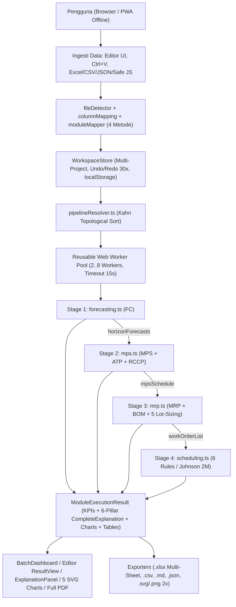

# Product Requirements Document (PRD) — Ha Jodeya

| Atribut | Nilai |
| :--- | :--- |
| **Nama Produk (Usulan)** | **Ha Jodeya** — *4-Stage Production Planning & Scheduling Workbench* |
| **Versi Dokumen** | `1.0.0-draft` (Menunggu Review & Persetujuan) |
| **Cakupan Metode** | **4 Metode Inti PPIC**: `Forecasting (FC)` · `MPS (MPS)` · `MRP (MR)` · `Scheduling (SC)` |
| **Referensi Paritas Fitur** | **OmniQM Studio v1.2** (100% fitur workbench, difokuskan & dioptimalkan untuk 4 metode) |
| **Dokumen Terkait** | [Project Planning](file:///home/antigravity/.gemini/jetski/brain/v1/default/jetski_remote_agents_3p_devbox/144ad6da-5065-4c95-aac2-f6a9e55b3acd/PROJECT_PLANNING.md) · [Design Plan](file:///home/antigravity/.gemini/jetski/brain/v1/default/jetski_remote_agents_3p_devbox/144ad6da-5065-4c95-aac2-f6a9e55b3acd/DESIGN_PLAN.md) |

---

## 1. Ringkasan Eksekutif & Visi Produk

### 1.1 Latar Belakang & Masalah yang Diselesaikan
Pada praktik *Production Planning and Inventory Control* (PPIC) maupun pembelajaran Teknik Industri & Manajemen Operasi, **empat tahapan inti perencanaan produksi** selalu berjalan saling berantai:

$$\text{Forecasting (Permintaan)} \longrightarrow \text{MPS (Jadwal Induk)} \longrightarrow \text{MRP (Kebutuhan Material)} \longrightarrow \text{Scheduling (Jadwal Lantai Produksi)}$$

Aplikasi POM-QM umum (termasuk katalog 16 modul penuh) sangat kaya namun sering kali terasa terlalu luas saat pengguna hanya membutuhkan **alur terfokus 4 metode PPIC** secara cepat, mendalam, dan terintegrasi. Selain itu, pada OmniQM Studio sebelumnya, fungsi MPS masih digabungkan sebagai output turunan dari *Aggregate Planning*, belum berdiri sebagai modul **MPS (Master Production Schedule)** penuh dengan *Time Fence (DTF/PTF)*, *Projected Available Balance (PAB)*, *Available-to-Promise (ATP Discrete & Cumulative)*, dan pengecekan kapasitas *Rough-Cut Capacity Planning (RCCP)*.

### 1.2 Visi Produk & Proporsi Nilai
**Ha Jodeya** adalah aplikasi web analitik modern (*client-side* 100%, PWA offline-ready) yang mempertahankan **seluruh kecanggihan fitur OmniQM Studio v1.2**, namun memfokuskannya secara tajam hanya pada **4 metode inti PPIC** dengan:
1. **Rantai PPIC 4-Tahap Terpadu (`FC → MPS → MRP → SC`):** Aliran data otomatis satu klik dari proyeksi permintaan ke jadwal induk MPS, ledakan BOM MRP, hingga urutan kerja mesin *Scheduling* berbasis DAG (*Directed Acyclic Graph*).
2. **Penjelasan & Interpretasi Jawaban Mendalam 6-Pilar di Setiap Metode:** Setiap hasil perhitungan tidak hanya menampilkan angka akhir, tetapi wajib menjawab **"Apa artinya?"** dan **"Mengapa jawaban ini yang keluar?"** melalui arsitektur **`CompleteExplanation` (6-Pilar)** + `DeepAnalysis` berbasis angka input aktual pengguna — mencakup Kesimpulan Bahasa Sehari-hari, Bedah Arti & Dampak Setiap Angka, Langkah Rumus + Substitusi Angka Aktual, Alasan/Pembuktian Mengapa Jawaban Ini Terpilih (*Why Optimal / Causal Reasoning*), Diagnosa Risiko & Rekomendasi Aksi, serta Kamus Istilah Modul. Dilengkapi saklar **Mode Lengkap / Mode Ringkas**, tombol **Salin / Unduh Markdown (`.md`)**, dan tampil konsisten di UI, cetak PDF, Excel, dan CSV.
3. **Paritas Fitur Penuh OmniQM Studio v1.2:** Eksekusi batch paralel via *Reusable Web Worker Pool*, upload universal bebas `eval()` (Excel multi-sheet, multi-CSV, JSON, semua file `.js`), *Interactive Column Mapping*, tempel langsung `Ctrl+V` dari Excel, komparasi multi-skenario *What-If* (hingga 5 skenario), multi-proyek lokal, Undo/Redo 30 langkah, Command Palette (`Ctrl+K`), grafik SVG interaktif (ekspor `.svg` & `.png` 2x), laporan PDF lengkap, dan Dark Mode.
4. **Desain Modern & Hierarki Visual Tegas:** Navigasi dan tata letak dirancang khusus untuk 4 tahap berurutan (*4-Stage PPIC Spine*), menghilangkan kebisingan katalog 16 modul sehingga alur input → analisis → keputusan terbaca dalam hitungan detik.

> [!IMPORTANT]
> **Peningkatan Kunci pada Modul MPS:** Berbeda dari OmniQM Studio (yang menggunakan *Aggregate Planning*), Ha Jodeya menghadirkan **modul MPS murni standar buku teks PPIC** (Heizer & Render, Fogarty, Jacobs & Chase, Gaspersz) lengkap dengan *Forecast vs Customer Orders*, *DTF/PTF*, *PAB*, *MPS Receipts* (multi aturan lot-sizing), *ATP Discrete & Cumulative*, serta *RCCP Capacity Check*.

---

## 2. Target Pengguna, Persona & User Stories

### 2.1 Persona Pengguna

| ID | Persona | Konteks Penggunaan | Kebutuhan Utama |
| :--- | :--- | :--- | :--- |
| **P1** | **Mahasiswa Teknik Industri / Manajemen Operasi** | Praktikum PPIC, tugas besar perencanaan produksi terpadu, dan persiapan ujian. | Input cepat dari Excel/`Ctrl+V`, penjelasan langkah rumus + alasan keluarnya jawaban untuk memvalidasi hitungan manual, grafik SVG & PDF siap kumpul. |
| **P2** | **Dosen & Asisten Lab PPIC** | Mendemonstrasikan rambatan perubahan permintaan dari Forecasting sampai Scheduling di kelas. | Simulasi *What-If* 5 skenario berdampingan, preset 1-klik 4 tahap PPIC, akurasi numerik terverifikasi buku teks, dan akses web tanpa instalasi. |
| **P3** | **Planner PPIC & Supervisor Produksi UKM/Manufaktur** | Menyusun jadwal mingguan/bulanan dari proyeksi penjualan hingga penjadwalan mesin. | Privasi 100% lokal di browser, upload workbook Excel internal multi-sheet, deteksi dini *overload* RCCP & *Past-Due* MRP, serta ekspor laporan `.xlsx` siap rapat. |

### 2.2 User Stories Utama

| ID | Persona | User Story | Referensi |
| :--- | :--- | :--- | :--- |
| `US-01` | P1, P2 | Sebagai pengguna, saya ingin menjalankan seluruh 4 metode (Forecasting, MPS, MRP, Scheduling) secara paralel dalam satu klik agar langsung melihat kesehatan seluruh rantai produksi di satu dashboard. | `FR-01`, `FR-02` |
| `US-02` | P1, P3 | Sebagai perencana PPIC, saya ingin menautkan output `Forecasting → MPS → MRP → Scheduling` secara otomatis sehingga saat angka permintaan berubah, seluruh jadwal induk, kebutuhan komponen, dan jadwal mesin ikut terhitung ulang. | `FR-03` |
| `US-03` | P1, P2, P3 | Sebagai pengguna, saya ingin membaca penjelasan detail 6-Pilar atas jawaban yang keluar di setiap metode—termasuk arti tiap angka, substitusi rumus dengan angka input saya, dan **alasan mengapa jawaban tersebut yang keluar/terpilih**—agar saya benar-benar memahami dasar keputusannya. | `FR-04` |
| `US-04` | P1, P3 | Sebagai analis data, saya ingin mengunggah 1 file Excel 4 sheet, banyak file CSV, JSON proyek, atau file JS bebas — serta menempel tabel via `Ctrl+V` dari Excel — dengan pemetaan kolom interaktif bila header berbeda. | `FR-05` |
| `US-05` | P2, P3 | Sebagai pengambil keputusan, saya ingin menyimpan hingga 5 skenario *What-If* (mis. *Pesimis*, *Baseline*, *Optimis*) dan melihat selisih (`Δ` & `%`) secara berdampingan. | `FR-02` |
| `US-06` | P1, P3 | Sebagai pengguna, saya ingin mengekspor hasil ke Excel multi-sheet (termasuk penjelasan lengkap), CSV per modul, ringkasan Markdown (`.md`), gambar grafik `.svg`/`.png` 2x, proyek `.json`, atau Laporan PDF Lengkap dengan halaman sampul. | `FR-06`, `FR-07` |
| `US-07` | P1, P3 | Sebagai pengguna di area pabrik/kelas tanpa internet stabil, saya ingin aplikasi bekerja 100% offline (PWA), menyimpan multi-proyek secara lokal, serta memiliki Undo/Redo dan Mode Gelap. | `FR-08` |

---

## 3. Spesifikasi Fungsional 4 Metode Inti (`FR-01`)

Setiap engine ditulis sebagai **fungsi TypeScript murni (bebas React/DOM)** yang berjalan identik di *Web Worker Pool* dan runner tes Vitest, dan setiap hasil wajib disertai **Penjelasan & Interpretasi Jawaban 6-Pilar** berbasis angka aktual.

### 3.1 Metode 1 — Forecasting (`FC` / Peramalan Permintaan)

| Aspek | Spesifikasi Detail |
| :--- | :--- |
| **Metode Evaluasi Serentak (7 Metode)** | 1) Naive ($F_t = Y_{t-1}$), 2) Simple Moving Average (`SMA`, window $k$), 3) Weighted Moving Average (`WMA`, auto-normalisasi bobot saat jendela terpotong), 4) Single Exponential Smoothing (`SES`, $\alpha$), 5) Double Exponential Smoothing / Holt's Linear Trend ($\alpha, \beta$), 6) Linear Trend Regression (`OLS`: $\hat{Y} = a + bt$, $R^2$), 7) Seasonal Decomposition / Holt-Winters (*Additive* & *Multiplicative*, siklus $L$). |
| **Fitur Optimasi & Validasi** | **Auto-Optimize** $(\alpha, \beta)$ via *Grid Search* meminimalkan MAD; evaluasi metrik `MAD`, `MSE`, `RMSE`, `MAPE` (guard $Y_t = 0$), `Mean Bias`, dan `Tracking Signal` (peringatan otomatis jika $\|TS\| > 4$); proyeksi multi-horizon $h = 1..24$ periode. |
| **Visualisasi SVG** | `SvgLineChart` — Aktual Historis vs Fitted Metode Terbaik vs Proyeksi Horizon + Garis Tren Linear (hover tooltip + crosshair + unduh SVG/PNG 2x). |
| **Output Pipeline (`derivedValues`)** | `horizonForecasts` (array deret $h$ periode → target `MPS.forecastDemand`), `nextPeriodForecast`, `annualizedForecast12`, `bestMad`, `bestMethod`, `rSquared`, `trendSlope`, `tunedAlpha`, `tunedBeta`. |
| **Penjelasan Detail Jawaban (6-Pilar)** | **1) Kesimpulan Inti:** Metode pemenang, angka proyeksi periode +1 s.d. $+h$, dan grade akurasi MAPE. **2) Bedah Arti Angka:** Makna & dampak bisnis `MAD`, `RMSE`, `MAPE`, `R²`, `Mean Bias`, dan `Tracking Signal`. **3) Langkah & Substitusi Aktual:** Persamaan OLS $\hat{Y} = a + bt$, perhitungan MAD/MAPE dengan angka aktual, dan hasil Grid Search $(\alpha, \beta)$. **4) Mengapa Jawaban Ini Keluar:** Penjelasan kausal mengapa metode pemenang mengalahkan runner-up & metode lain (mis. mengapa Holt mengungguli SMA/SES karena data memiliki tren konsisten $+b$/periode atau pola musiman $L$). **5) Risiko & Rekomendasi:** Diagnosa bias (*over/under-forecast*), alarm $\|TS\| > 4$, dan estimasi *safety stock* ($\approx 1.25 \cdot \text{MAD}$). **6) Kamus Istilah:** Definisi ringkas MAD, MAPE, Tracking Signal, $R^2$, dan Smoothing $(\alpha, \beta)$. |

### 3.2 Metode 2 — MPS (`MPS` / Master Production Schedule)

| Aspek | Spesifikasi Detail |
| :--- | :--- |
| **Parameter Input** | Nama Produk Jadi, *Beginning Inventory* ($I_0$), *Safety Stock* ($SS$), **Time Fences**: *Demand Time Fence* (`DTF` — zona *Frozen*), *Planning Time Fence* (`PTF` — zona *Slushy*, sesudahnya *Liquid*), aturan Lot-Sizing MPS (`FOQ`, `L4L`, `Lot-Multiple`, `POQ`), ukuran lot ($Q$) / periode ($P$), biaya setup ($S$), biaya simpan ($H$), jam standar per unit (untuk RCCP), serta tabel periodik (`Periode`, `Forecast`, `Customer Orders`, `Firm MPS` opsional, `Kapasitas Tersedia`). |
| **Algoritma & Perhitungan Inti** | 1) **Effective Demand ($D_t$)**: Zona Frozen ($t \le \text{DTF}$) menggunakan `Customer Orders` (atau opsi $\max(F_t, CO_t)$); zona Slushy/Liquid menggunakan $\max(F_t, CO_t)$ (atau `Forecast` murni di Liquid sesuai opsi mode). 2) **Projected Available Balance ($PAB_t$) & MPS Receipts ($MPS_t$)**: Jika $PAB_{t-1} - D_t < SS$, picu produksi $MPS_t$ sesuai aturan lot-sizing (menghormati *Firm MPS*) sehingga $PAB_t = PAB_{t-1} + MPS_t - D_t \ge SS$. 3) **Available-to-Promise ($ATP_t$)**: Menghitung **Discrete ATP** ($ATP_1 = I_0 + MPS_1 - \sum CO$ hingga sebelum MPS berikutnya; $ATP_t = MPS_t - \sum CO$ pada periode bermuatan MPS) dan **Cumulative ATP**, dengan peringatan kritis jika $ATP < 0$ (*over-promise*). 4) **Rough-Cut Capacity Planning (RCCP)**: $\text{Load}_t = MPS_t \times \text{StdHours}$, Utilisasi $U_t = (\text{Load}_t / \text{Cap}_t) \times 100\%$, deteksi periode *Overload* ($U_t > 100\%$). 5) **Komparasi Biaya Lot MPS**: Membandingkan total biaya (Setup + Simpan PAB) lintas aturan `L4L`, `FOQ`, `Lot-Multiple`, dan `POQ`. |
| **Visualisasi SVG** | 1) `SvgLineChart` — Perbandingan *Effective Demand*, *MPS Receipts*, dan *Projected Available Balance (PAB)* vs garis *Safety Stock*. 2) `SvgBarChart` — **Profil Kapasitas RCCP** (*Load* vs *Available Capacity* per periode, sorotan merah saat $U_t > 100\%$). |
| **Output Pipeline (`derivedValues`)** | `mpsSchedule` (array deret $MPS_t$ per periode → target `MRP.grossRequirements`), `totalMpsUnits`, `totalEffectiveDemand`, `minPab`, `totalAtp`, `peakCapacityUtilPct`, `overloadCount`, `totalMpsCost`. |
| **Penjelasan Detail Jawaban (6-Pilar)** | **1) Kesimpulan Inti:** Kelayakan jadwal induk (Layak Kapasitas / Overload RCCP / Over-Promise ATP), total batch & unit MPS. **2) Bedah Arti Angka:** Makna & dampak `Effective Demand`, `PAB`, `MPS Receipts`, `Discrete & Cumulative ATP`, serta `Utilisasi RCCP`. **3) Langkah & Substitusi Aktual:** Contoh substitusi nyata pemilihan $D_t$ di zona Frozen/Slushy/Liquid, pemicu $PAB_{t-1} - D_t < SS \Rightarrow MPS_t$, hitungan `ATP`, dan hitungan `Utilisasi RCCP`. **4) Mengapa Jawaban Ini Keluar:** Menjelaskan persis **mengapa MPS muncul di periode tertentu dan 0 di periode lain** (karena saldo PAB turun menembus Safety Stock), mengapa periode tertentu *Overload* (beban jam $>$ kapasitas), serta perbandingan biaya aturan lot aktif vs aturan lot termurah. **5) Risiko & Rekomendasi:** Peringatan *Over-Promise* ($ATP < 0$), *Overload* RCCP ($U_t > 100\%$), dan rekomendasi *load-leveling* / lembur / penyesuaian lot. **6) Kamus Istilah:** Definisi DTF, PTF, PAB, Discrete vs Cumulative ATP, dan RCCP. |

### 3.3 Metode 3 — MRP (`MR` / Material Requirements Planning)

| Aspek | Spesifikasi Detail |
| :--- | :--- |
| **Struktur Input & BOM** | Horizon periode ($T$), daftar komponen BOM multi-level & multi-parent (`Item`, `Level`, `Parent`, `Qty/Parent`, `Lead Time`, `On-Hand`, `Safety Stock`, `Scheduled Receipts`, `Lot Sizing`, `Lot Size/POQ`, `Setup Cost`, `Holding Cost`), serta `Gross Requirements` Level-0 (bisa diinjeksi otomatis dari `MPS.mpsSchedule`). |
| **Algoritma & Fitur Inti** | 1) **Low-Level Coding & Deteksi Siklus BOM**: Pengurutan topologis otomatis agar *common parts* mengakumulasi *Planned Order Release* dari seluruh induknya. 2) **Netting & Offsetting Penuh**: $GR_t$, $SR_t$, $POH_t$, $NR_t = \max(0, GR_t + SS - POH_{t-1} - SR_t)$, $PORc_t$, dan $PORel_t$ digeser mundur sebesar *Lead Time*. 3) **Deteksi Rambatan Past-Due**: Peringatan kritis jika rilis jatuh sebelum periode 1 ($t - LT < 0$) termasuk rambatannya dari induk ke komponen anak. 4) **5 Metode Lot-Sizing + Komparasi Biaya Otomatis**: `L4L`, `FOQ`, `POQ`, `EOQ`, dan `Silver-Meal (SM)` dengan penanda bintang (`★`) pada metode paling ekonomis & kalkulasi total potensi penghematan. |
| **Visualisasi SVG** | 1) `SvgBarChart` — Total *Planned Order Release* per komponen BOM & perbandingan biaya 5 metode Lot-Sizing. 2) **`SvgBomTree`** — Diagram struktur pohon BOM multi-level (menampilkan level, kuantitas per induk, lead time, dan badge status *Past-Due* bila ada). |
| **Output Pipeline (`derivedValues`)** | `level0PlannedReleases`, `workOrderList` (ringkasan rilis order untuk diinjeksi menjadi daftar pekerjaan pada `Scheduling.jobs` via pengali waktu proses/unit), `totalPlannedReleases`, `totalOrders`, `totalMrpCost`, `optimalLotSizingCost`, `potentialSavings`, `totalPastDueUnits`. |
| **Penjelasan Detail Jawaban (6-Pilar)** | **1) Kesimpulan Inti:** Ringkasan ledakan BOM, total rilis order, total biaya relevan, status *Past-Due*, dan peluang hemat lot-sizing. **2) Bedah Arti Angka:** Makna & dampak `Gross Req`, `Scheduled Receipts`, `POH`, `Net Req`, `PORc`, `PORel`, `Setup Cost`, dan `Holding Cost`. **3) Langkah & Substitusi Aktual:** Jejak perhitungan *Low-Level Coding* (*common part*), netting satu periode kunci dengan angka aktual, pergeseran *Lead Time* (*offsetting*), dan rumus Silver-Meal/EOQ. **4) Mengapa Jawaban Ini Keluar:** Menjelaskan **mengapa angka Gross Req komponen anak muncul di periode tersebut** (rambatan `PORel Induk × Qty/Parent`), **mengapa metode lot tertentu (`★`) paling murah** dibanding 4 metode lain (keseimbangan biaya setup vs simpan), dan penyebab timbulnya *Past-Due* ($t - LT < 0$). **5) Risiko & Rekomendasi:** Audit tiap item suboptimal, alarm rambatan *Past-Due*, serta langkah *expediting* / penguncian *Firm Planned Orders*. **6) Kamus Istilah:** Definisi BOM, Low-Level Coding, Netting, Offsetting, Past-Due, L4L/FOQ/POQ/EOQ/Silver-Meal. |

### 3.4 Metode 4 — Scheduling (`SC` / Shop-Floor & Job Shop Scheduling)

| Aspek | Spesifikasi Detail |
| :--- | :--- |
| **Mode Penjadwalan** | **Mode A — Single-Machine Sequencing (6 Aturan Serentak):** `FCFS`, `SPT`, `WSPT` (berbobot $w_i$), `LPT`, `EDD`, dan `CR` (*Critical Ratio*). **Mode B — 2-Machine Flow Shop (Algoritma Johnson):** Optimasi urutan untuk meminimalkan *Makespan* ($C_{\max}$) pada dua mesin berurutan ($M_1 \rightarrow M_2$). |
| **Metrik & Validasi** | Single-Machine: `Avg Flow Time`, `Weighted Flow Time`, `Utilization (%)`, `Avg Jobs in System (WIP)`, `Avg Tardiness`, `Max Tardiness`, `Tardy Count`, `Makespan`. Johnson 2-Machine: `Makespan`, `Total M1/M2 Time`, `Total Idle Time M2`, `Utilization M1 & M2`, tabel jadwal mulai/selesai per mesin. |
| **Visualisasi SVG** | 1) `SvgBarChart` — Perbandingan *Avg Flow Time* & *Avg Tardiness* antar 6 aturan prioritas. 2) `SvgGanttChart` — Gantt Chart mesin tunggal (penanda hijau = tepat waktu, merah = melewati *due date*, abu-abu = margin *slack*) atau Gantt Chart 2-Mesin Johnson lengkap dengan blok *idle time*. |
| **Output Pipeline (`derivedValues`)** | `bestFlowTime`, `wsptWeightedFlow`, `minAvgLateness`, `minMaxLateness`, `bestMaxLateRule`, `makespan`. Menerima injeksi dari `MRP.workOrderList` / `MRP.level0PlannedReleases`. |
| **Penjelasan Detail Jawaban (6-Pilar)** | **1) Kesimpulan Inti:** Urutan kerja terbaik sesuai sasaran (SPT untuk antrean/WIP, WSPT untuk bobot prioritas, EDD untuk batas keterlambatan, atau urutan optimal Johnson untuk Makespan 2-Mesin). **2) Bedah Arti Angka:** Makna & dampak `Flow Time`, `Weighted Flow Time`, `Makespan`, `WIP (Avg Jobs in System)`, `Utilization`, `Avg/Max Tardiness`, dan `Idle Time M2`. **3) Langkah & Substitusi Aktual:** Perhitungan rasio prioritas ($t_i$, $t_i/w_i$, $d_i$, $CR_i$), penjumlahan $\sum C_i / n$, atau urutan penempatan kiri-kanan Algoritma Johnson dengan angka aktual tiap job. **4) Mengapa Jawaban Ini Keluar:** Menjelaskan **mengapa Makespan mesin tunggal selalu sama di semua aturan tetapi urutan tetap krusial**, mengapa SPT secara matematis selalu meminimalkan rata-rata Flow Time & WIP (pekerjaan singkat selesai lebih dulu sehingga tidak menahan antrean), mengapa EDD menjamin Max Tardiness minimum, atau mengapa penempatan Johnson meminimalkan waktu menganggur Mesin 2. **5) Risiko & Rekomendasi:** Analisis *trade-off* efisiensi lantai vs SLA pelanggan, daftar job yang terlambat, dan saran pemilihan aturan dispatching sesuai prioritas operasional. **6) Kamus Istilah:** Definisi Makespan, Flow Time, Tardiness, WIP, WSPT, Critical Ratio, dan Algoritma Johnson. |

---

## 4. Fitur Platform — Paritas Penuh OmniQM Studio v1.2

Seluruh fitur workbench OmniQM Studio wajib tersedia dengan cakupan yang bersih dan disesuaikan untuk 4 metode:

| Kode | Fitur Parity OmniQM Studio | Spesifikasi di Ha Jodeya |
| :--- | :--- | :--- |
| `FR-02` | **Parallel Batch Execution & Multi-Scenario What-If** | *Reusable Web Worker Pool* (`2..8` worker, timeout `15.000 ms`, FIFO queue, auto-recovery, debounced live preview di Editor). Dashboard *Master Batch Matrix* + *inline detail drawer*. Simpan hingga **5 Skenario What-If** (mis. *Pesimis, Baseline, Optimis*) dengan perbandingan selisih absolut (`Δ`) dan persentase (`%`). |
| `FR-03` | **DAG Cross-Module Pipeline (4-Tahap PPIC)** | Algoritma Kahn *topological sort* + deteksi siklus (`hasCycle`) + visualisasi `SvgPipelineDag` interaktif. Mendukung injeksi skalar & deret array dengan faktor pengali (`multiplier`). **Preset 1-Klik Rantai PPIC 4-Tahap:** `FC.horizonForecasts → MPS.forecastDemand`, `MPS.mpsSchedule → MRP.grossRequirements`, `MRP.workOrderList → SC.jobs`. |
| `FR-04` | **Penjelasan & Interpretasi Jawaban 6-Pilar (`CompleteExplanation`) + `DeepAnalysis`** | Setiap hasil metode otomatis menghasilkan **6 Pilar Penjelasan Lengkap** berbasis angka input aktual: **1) Kesimpulan Inti & Bahasa Sehari-hari**, **2) Bedah Arti & Dampak Setiap Angka**, **3) Langkah Perhitungan & Substitusi Angka Aktual**, **4) Alasan & Pembuktian Mengapa Jawaban Ini Keluar/Optimal**, **5) Diagnosa Risiko & Rekomendasi Aksi Bernomor**, dan **6) Kamus Istilah Modul**. Dilengkapi saklar **Mode Lengkap / Mode Ringkas**, tombol **Salin Penjelasan (Markdown)** & **Unduh `.md`**, serta kartu ringkas *"Panduan Metode"* di editor. |
| `FR-05` | **Universal Data Ingestion & Direct Paste (`Ctrl+V`)** | Drag-and-drop: 1) Excel multi-sheet (`.xlsx`/`.xls`, lazy-loaded SheetJS), 2) Multi-file `.csv`/`.tsv`, 3) Bundel proyek `.hajodeya.json`/`.json`, 4) **Semua file JavaScript (`.js`, `.mjs`, `.cjs`, teks bebas)** dengan parser pasif **0 penggunaan `eval()`/`new Function()`** (`MAX_TOKENS = 200.000`). Dilengkapi deteksi otomatis modul (4 metode), **Interactive Column Mapping Wizard**, dan **Direct Paste `Ctrl+V`** dari Excel/Google Sheets pada seluruh editor grid. |
| `FR-06` | **Visualisasi SVG Interaktif & Ekspor HD** | 5 komponen grafik SVG murni (`SvgLineChart`, `SvgBarChart`, `SvgGanttChart`, `SvgBomTree`, `SvgPipelineDag`) dengan *hover tooltip + crosshair*, sumbu `tabular-nums`, *clipPath/marker ID* unik, dan tombol unduh **`.svg`** & **`.png` (2x Hi-DPI)**. |
| `FR-07` | **Ekspor Laporan Multi-Format & Master Template** | 1) **Template Master Excel 4-Sheet** (`.xlsx` siap edit & upload ulang), 2) **Ekspor Hasil Excel Multi-Sheet** (auto-width kolom, sheet `Ringkasan_Eksekutif` + 1 sheet detail per pekerjaan lengkap dengan Penjelasan 6-Pilar & tabel), 3) **Ekspor CSV per modul**, 4) **Ekspor / Salin Penjelasan Markdown (`.md`)**, 5) **Simpan/Muat Bundel Proyek `.json`**, 6) **Cetak Layar** & **Laporan PDF Lengkap** (halaman sampul + *page-break* per metode + seluruh 6 Pilar Penjelasan & rumus otomatis terbuka). |
| `FR-08` | **Produktivitas, Ketahanan & PWA Offline** | **Undo/Redo (`Ctrl+Z` / `Ctrl+Y`, 30 langkah)**, **Command Palette (`Ctrl+K`)**, shortcut **`Ctrl+Enter`** (Jalankan Semua), **Multi-Proyek Lokal** (`localStorage` + proteksi kuota), **Light & Dark Workbench Theme**, **Mobile Collapsible Drawer**, **`WorkspaceErrorBoundary`** (pemulihan backup `.json`), **Modal Arsitektur Sistem**, serta **Service Worker PWA** berstempel SHA-256 (*Full Bundle Precaching*) + konfigurasi siap deploy **Vercel & Netlify**. |

---

## 5. Alur Arsitektur Data (4-Tahap PPIC)

---

## 6. Kebutuhan Non-Fungsional (*Non-Functional Requirements*)

| Kode | Kategori | Target Terukur |
| :--- | :--- | :--- |
| **NFR-01** | **Performa** | Eksekusi batch penuh 4 metode berantai `< 150 ms` di browser desktop; main-thread bebas *freeze* (Web Worker); *lazy-load* SheetJS `xlsx` hanya saat import/ekspor Excel. |
| **NFR-02** | **Akurasi Matematis** | Toleransi numerik $\le 10^{-6}$; seluruh rumus selaras buku teks standar (*Heizer & Render*, *Jacobs & Chase*, *Fogarty*, *Gaspersz*); 0 `NaN` atau `undefined` di seluruh KPI, tabel, grafik, dan narasi penjelasan 6-Pilar. |
| **NFR-03** | **Keamanan & Privasi** | 100% pemrosesan lokal sisi klien (0 data dikirim ke server); parser JS murni pasif tanpa `eval()`/`new Function()`; sanitasi nama sheet Excel. |
| **NFR-04** | **Desain & Aksesibilitas** | Hierarki visual 4-lapisan yang tegas, single `<h1>` per tampilan, `tabular-nums` di semua angka, kontras WCAG AA pada Light & Dark Theme, keyboard navigation (`Ctrl+K`, `Ctrl+Z/Y`, `Ctrl+Enter`), dan responsif desktop/tablet/mobile. |
| **NFR-05** | **Kualitas Kode & Arsitektur** | Pemisahan ketat 5 lapisan (`UI → Store/Workers → Core/Explanation/Pipeline → IO → Pure Engines`); `oxlint` 0 error/0 warning; `tsc --noEmit` strict mode 0 error. |

---

## 7. Matriks Kriteria Penerimaan (*Acceptance Criteria*)

| ID | Kriteria Penerimaan | Metode Verifikasi |
| :--- | :--- | :--- |
| `AC-01` | Seluruh 4 engine (`FC`, `MPS`, `MR`, `SC`) lulus kasus standar buku teks & *edge-case* (termasuk DTF/PTF, Discrete/Cumulative ATP, *over-promise* ATP `< 0`, *overload* RCCP `> 100%`, BOM multi-parent & rambatan *Past-Due*, 5 lot-sizing MRP, WSPT & Johnson 2-Mesin). | Suite unit test Vitest (`tests/engines/`) |
| `AC-02` | Seluruh 4 metode menghasilkan **`CompleteExplanation` 6-Pilar** non-kosong berbasis angka input aktual (`keyDecision`, `plainSummary`, `metricBreakdown`, `workedSteps` dengan substitusi angka nyata, `whyOptimal` alasan keluarnya jawaban, `risksAndNotes`, `recommendations`, dan `glossary`) dengan 0 `NaN`/`undefined` serta tampil di UI, PDF, Markdown, Excel, dan CSV. | Automated 6-Pillar audit test + inspeksi ekspor |
| `AC-03` | Preset Pipeline 4-Tahap (`FC → MPS → MRP → SC`) mengeksekusi berurutan sesuai DAG Kahn dan menyuntikkan output ke input hilir tanpa siklus. | Pipeline integration test + Live browser E2E |
| `AC-04` | Upload workbook Excel 4 sheet, multi-CSV, JSON proyek, serta file `.js` bebas terdeteksi, dapat dipetakan lewat *Column Mapping Wizard*, dan tempel `Ctrl+V` berfungsi di seluruh 4 editor. | `tests/io/` (parsers + safe JS upload) |
| `AC-05` | Seluruh fitur workbench (5 skenario *What-If*, Multi-Proyek, Undo/Redo, Command Palette, SVG/PNG 2x Export, Dark Mode, Full PDF, PWA Service Worker SHA-256) berfungsi dengan 0 *console/page error* di Chromium. | `npm run lint`, `tsc --noEmit`, `npm test`, `npm run build`, & Chromium E2E check |
