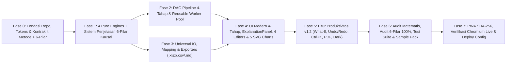

# Project Planning & Implementation Roadmap — Ha Jodeya

| Atribut | Nilai |
| :--- | :--- |
| **Nama Proyek** | **Ha Jodeya** — Aplikasi Web PPIC 4 Metode (*Forecasting, MPS, MRP, Scheduling*) |
| **Metodologi** | *Iterative-Incremental* & *Verification-Driven Development (VDD)* |
| **Target Kualitas** | `oxlint` 0 error/warning · `tsc --noEmit` 0 error · 100% Vitest lulus · 0 Chromium runtime error |
| **Dokumen Terkait** | [PRD](file:///home/antigravity/.gemini/jetski/brain/v1/default/jetski_remote_agents_3p_devbox/144ad6da-5065-4c95-aac2-f6a9e55b3acd/PRD.md) · [Design Plan](file:///home/antigravity/.gemini/jetski/brain/v1/default/jetski_remote_agents_3p_devbox/144ad6da-5065-4c95-aac2-f6a9e55b3acd/DESIGN_PLAN.md) |

---

## 1. Strategi Eksekusi & Stack Teknologi

### 1.1 Prinsip Eksekusi (*Verification-Driven Delivery*)
Setiap fase pembangunan hanya dinyatakan selesai (*Done*) bila melewati 4 gerbang mutu otomatis:
1. **`npm run lint`** (`oxlint` — 0 warning, 0 error)
2. **`npx tsc --noEmit`** (TypeScript strict mode — 0 error)
3. **`npm test`** (Vitest suite untuk akurasi 4 engine, `DeepAnalysis`, DAG Pipeline, IO/Safe JS, & PWA — 100% lulus)
4. **`npm run build`** (Bundle produksi Vite + *code-splitting* + stempel SHA-256 `dist/sw.js`)

### 1.2 Stack Teknologi Terkunci (Selaras OmniQM Studio)

| Lapisan | Teknologi | Peran dalam Sistem |
| :--- | :--- | :--- |
| **UI & Framework** | React 19, TypeScript (Strict), Lucide React | Antarmuka *Modern Precision PPIC Workbench* |
| **Styling** | Modular Vanilla CSS (`tokens → base → layout → components`) | Kontrol penuh hierarki visual, Light/Dark Theme, & `@media print` tanpa bloat |
| **Build & Bundler** | Vite + `@vitejs/plugin-react` + custom SW SHA-256 plugin | ESM cepat, *lazy chunk* SheetJS, *Full Bundle Precaching* PWA |
| **Konkurensi** | Native Module Web Workers (`workerPool.ts` + `solver.worker.ts`) | Eksekusi batch paralel & live preview anti-freeze |
| **Spreadsheet IO** | SheetJS `xlsx` (dynamic lazy import) + Safe Zero-`eval()` JS Parser | Import/export Excel 4-sheet, multi-CSV, JSON, & semua file `.js` |
| **Pengujian & CI** | Vitest, Oxlint, GitHub Actions (Node 22) | Verifikasi otomatis matematika, parser, & PWA pada setiap commit |
| **Hosting** | Vercel (`vercel.json`) & Netlify (`netlify.toml`), PWA Offline | Auto-deploy, anti-stale-cache, & eksekusi 100% offline |

---

## 2. Arsitektur 5-Lapisan & Struktur Folder Proyek

Pemisahan lapisan dijaga ketat agar seluruh engine matematika dan pipeline bebas dari ketergantungan DOM/React:

```text
ha-jodeya/
├── docs/
│   ├── PRD.md                    # Spesifikasi produk final
│   ├── PROJECT_PLANNING.md       # Rencana proyek & milestone
│   ├── DESIGN_SYSTEM.md          # Standar desain & hierarki visual
│   └── ARCHITECTURE.md           # Arsitektur 5-lapisan & alur DAG
├── public/
│   ├── icon.svg                  # Logo geometris 4-Tahap PPIC
│   ├── manifest.webmanifest      # Metadata PWA installable
│   ├── sw.js                     # Service Worker (stempel SHA-256 saat build)
│   ├── _headers & _redirects     # Aturan anti-stale-cache Netlify
├── samples/                      # Dataset contoh siap upload (.xlsx 4-sheet, .csv, .json, .js)
├── src/
│   ├── core/
│   │   ├── types/                # module.types.ts (FC, MPS, MR, SC), explanation.types.ts,
│   │   │                         # workspace.types.ts, chart.types.ts
│   │   ├── math/                 # matrix.ts, rounding & statistical helpers
│   │   ├── registry/             # moduleRegistry.ts (metadata, conceptGuide, pipeline ports 4 metode)
│   │   ├── explanation/          # Sistem Penjelasan 6-Pilar: explanationBuilder.ts,
│   │   │                         # ppicExplanations.ts (FC, MPS, MR, SC), glossaryCatalog.ts
│   │   └── pipeline/             # pipelineResolver.ts (Kahn DAG + array/workOrder injector)
│   ├── engines/
│   │   ├── forecasting.ts        # 7 metode + Auto-Tune + DeepAnalysis + CompleteExplanation (6-Pilar)
│   │   ├── mps.ts                # DTF/PTF + PAB + Lot-Sizing + Discrete/Cum ATP + RCCP + 6-Pilar
│   │   ├── mrp.ts                # Low-Level Coding BOM + 5 Lot-Sizing + Past-Due + 6-Pilar
│   │   ├── scheduling.ts         # 6 Single-Machine Rules + Johnson 2-Machine + 6-Pilar
│   │   └── index.ts              # Central pure dispatcher solveModuleJob() + attachExplanation()
│   ├── workers/
│   │   ├── solver.worker.ts      # Web Worker entry
│   │   └── workerPool.ts         # Reusable Worker Pool (2..8 workers, 15s timeout, fallback)
│   ├── io/
│   │   ├── parsers/              # excelParser, csvParser, jsonParser, jsDataParser (zero-eval),
│   │   │                         # fileDetector, columnMapping, moduleMapper (4 metode)
│   │   ├── exporters/            # excelExporter (4-sheet template & report), csvExporter,
│   │   │                         # explanationExporter (.md & copy), jsonExporter
│   │   └── templates/            # sampleDatasets.ts (Preset Rantai PPIC 4-Tahap terpadu)
│   ├── store/
│   │   ├── workspaceContext.ts
│   │   ├── workspaceHistory.ts   # Undo/Redo (30 langkah) & What-If Snapshots (maks. 5)
│   │   └── workspaceStore.tsx    # Multi-Proyek lokal, tema, pipeline sync, localStorage guard
│   ├── styles/
│   │   ├── tokens.css            # Design tokens Light & Dark Theme
│   │   ├── base.css              # Reset, tipografi tabular-nums, print media
│   │   ├── layout.css            # TopBar, 4-Stage Spine Sidebar, Main Canvas, Responsive Drawer
│   │   └── components.css        # KPI Grid, ExplanationPanel 6-Pilar, Editors, Charts, Modals
│   └── ui/
│       ├── layouts/AppShell.tsx  # Shell utama + keyboard shortcuts (Ctrl+K, Ctrl+Z/Y, Ctrl+Enter)
│       ├── utils/                # gridPaste.ts (Ctrl+V Excel), chartExport.ts (SVG & 2x PNG)
│       └── components/
│           ├── TopBar.tsx, PpicSpineSidebar.tsx, BatchDashboard.tsx, ResultView.tsx
│           ├── ExplanationPanel.tsx  # Panel Penjelasan 6-Pilar (Mode Lengkap/Ringkas, Copy/Unduh .md)
│           ├── ModuleInputPanel.tsx, PipelineLinker.tsx, FileDropzone.tsx
│           ├── FullPrintReport.tsx, CommandPaletteModal.tsx, ArchitectureModal.tsx
│           ├── SystemStatusBanners.tsx, WorkspaceErrorBoundary.tsx
│           ├── editors/          # ForecastingEditor, MpsEditor, MrpEditor, SchedulingEditor
│           └── charts/           # SvgLineChart, SvgBarChart, SvgGanttChart, SvgBomTree,
│                                 # SvgPipelineDag, ChartExportActions
└── tests/
    ├── engines/                  # forecasting, mps, mrp, scheduling, explanation6PillarAudit
    ├── pipeline/                 # ppic4StageDag.test.ts
    ├── io/                       # parsers.test.ts, jsUpload.test.ts, exporters.test.ts
    └── pwa/                      # hostingAndSw.test.ts
```

---

## 3. Peta Jalan & Ketergantungan Antar-Fase



---

## 4. Work Breakdown Structure (WBS) Detail

### Fase 0 — Inisiasi Proyek, Kontrak Tipe & Fondasi Arsitektur
- **Tujuan:** Menyiapkan proyek Vite + React 19 + TypeScript strict + Oxlint + Vitest dengan kontrak data 4 metode dan kontrak Penjelasan 6-Pilar yang solid.
- **Deliverables:**
  - Scaffolding proyek, `tsconfig*.json`, `.oxlintrc.json`, `vite.config.ts`, `package.json`.
  - Kontrak tipe ketat di `src/core/types/` (`ForecastingInput`, `MpsInput`, `MrpInput`, `SchedulingInput`, `ModuleExecutionResult`, `DeepAnalysis`, **`CompleteExplanation`** 6-Pilar, `AuditStep`, `PipelineLink`, `WorkspaceState`).
  - Registri terpusat 4 metode (`moduleRegistry.ts`) berisi metadata tahap (`01`–`04`), port pipeline input/output, dan ringkasan panduan konsep metode (*Concept Guide*).

### Fase 1 — Implementasi 4 Pure Quantitative Engines & Sistem Penjelasan Jawaban 6-Pilar
- **Tujuan:** Membangun seluruh kecerdasan matematis dan **mesin narasi kausal 6-Pilar** (`src/core/explanation/`) sehingga setiap jawaban menjelaskan persis **apa artinya** dan **mengapa jawaban tersebut yang keluar**.
- **Deliverables:**
  - **`forecasting.ts` + Penjelasan 6-Pilar:** 7 metode, Auto-Tune $(\alpha, \beta)$, MAD/MSE/RMSE/MAPE/Bias/TS, penjelasan mengapa metode pemenang mengalahkan metode lain (tren/musiman/galat), bedah arti tiap metrik, substitusi rumus aktual, dan kamus istilah.
  - **`mps.ts` (Baru & Lengkap) + Penjelasan 6-Pilar:** Effective Demand berbasis DTF/PTF, PAB & MPS Receipts (`FOQ`, `L4L`, `Lot-Multiple`, `POQ`), komparasi biaya lot MPS, **Discrete & Cumulative ATP** + deteksi *over-promise*, **RCCP Capacity Check** + deteksi *overload*, serta penjelasan kausal mengapa MPS dipicu di periode tertentu, mengapa *overload* terjadi, dan perbandingan efisiensi lot.
  - **`mrp.ts` + Penjelasan 6-Pilar:** Low-Level Coding BOM multi-parent, deteksi siklus, netting & offsetting, rambatan *Past-Due*, 5 metode Lot-Sizing (`L4L`, `FOQ`, `POQ`, `EOQ`, `Silver-Meal`), ekspor `workOrderList` untuk Scheduling, serta penjelasan kausal rambatan induk → anak, penyebab *Past-Due*, dan alasan metode lot (`★`) termurah.
  - **`scheduling.ts` + Penjelasan 6-Pilar:** 6 aturan Single-Machine (`FCFS`, `SPT`, `WSPT`, `LPT`, `EDD`, `CR`) + Algoritma Johnson 2-Mesin, Gantt data, serta penjelasan kausal mengapa Makespan konstan di mesin tunggal, mengapa SPT meminimalkan Flow Time/WIP, mengapa EDD meminimalkan Max Tardiness, dan mengapa urutan Johnson menekan Idle Time M2.
  - **`src/core/explanation/`:** `explanationBuilder.ts`, `ppicExplanations.ts`, dan `glossaryCatalog.ts` untuk menyusun ke-6 pilar secara deterministik dari angka hasil aktual.

### Fase 2 — Pipeline Integrasi 4-Tahap (DAG) & Web Worker Pool
- **Tujuan:** Menghubungkan keempat metode menjadi rantai PPIC hidup yang dieksekusi paralel tanpa memblokir UI.
- **Deliverables:**
  - `pipelineResolver.ts` (Kahn topological sort, deteksi siklus, injeksi skalar, array horizon `FC → MPS`, jadwal produksi `MPS → MRP`, dan konversi work-order `MRP → SC`).
  - `workerPool.ts` + `solver.worker.ts` (pool `2..8` worker, timeout `15.000 ms`, antrean FIFO, auto-recovery, fallback sinkron untuk Vitest).
  - `sampleDatasets.ts` dengan **Preset 1-Klik Rantai PPIC 4-Tahap** yang koheren (studi kasus manufaktur nyata di mana angka Forecasting mengalir mulus hingga jadwal mesin).

### Fase 3 — Universal Data Ingestion, Mapping & Multi-Format Exporters
- **Tujuan:** Menyamai seluruh kapabilitas impor/ekspor OmniQM Studio secara aman tanpa `eval()`, ditambah ekspor penjelasan Markdown.
- **Deliverables:**
  - Parser `.xlsx`/`.xls` (lazy SheetJS), `.csv`/`.tsv`, `.json`, dan `jsDataParser.ts` (zero-`eval()`, `MAX_TOKENS = 200.000`).
  - `fileDetector.ts`, `columnMapping.ts`, dan `moduleMapper.ts` terkalibrasi khusus untuk 4 metode (`FC`, `MPS`, `MR`, `SC`).
  - `excelExporter.ts` (Template Master 4-Sheet + Laporan Multi-Sheet lengkap dengan Penjelasan 6-Pilar & auto-width), `csvExporter.ts`, **`explanationExporter.ts`** (Salin & Unduh Penjelasan `.md`), dan `jsonExporter.ts`.

### Fase 4 — Antarmuka Modern 4-Tahap, `ExplanationPanel` 6-Pilar, 4 Editor & 5 Grafik SVG
- **Tujuan:** Mengimplementasikan sistem desain dari [Design Plan](file:///home/antigravity/.gemini/jetski/brain/v1/default/jetski_remote_agents_3p_devbox/144ad6da-5065-4c95-aac2-f6a9e55b3acd/DESIGN_PLAN.md) dengan hierarki visual yang bersih dan responsif.
- **Deliverables:**
  - 4 lapisan CSS (`tokens.css`, `base.css`, `layout.css`, `components.css`) lengkap dengan Light & Dark Workbench Theme.
  - `TopBar`, `PpicSpineSidebar` (alur berurutan `01 FC → 02 MPS → 03 MR → 04 SC` + Multi-Project Switcher), `BatchDashboard` (Master Batch Matrix + inline drawer), `ResultView` + **`ExplanationPanel.tsx`** (6-Pilar Penjelasan Lengkap dengan saklar **Mode Lengkap / Mode Ringkas**, blok *"Mengapa Jawaban Ini Keluar?"*, tabel substitusi rumus aktual, kamus istilah, serta tombol Salin & Unduh `.md`), `PipelineLinker`, dan `FileDropzone` (dengan Column Mapping Wizard).
  - 4 Editor dedikasi (`ForecastingEditor`, `MpsEditor`, `MrpEditor`, `SchedulingEditor`) dilengkapi **Direct Paste `Ctrl+V`** (`gridPaste.ts`) dan debounced live preview.
  - 5 Grafik SVG murni (`SvgLineChart`, `SvgBarChart`, `SvgGanttChart`, **`SvgBomTree`**, `SvgPipelineDag`) dengan hover crosshair + tombol unduh `.svg` & `.png` 2x (`chartExport.ts`).

### Fase 5 — Fitur Produktivitas Workbench v1.2
- **Tujuan:** Melengkapi seluruh kenyamanan kerja analis setara OmniQM Studio v1.2.
- **Deliverables:**
  - **Multi-Scenario What-If** (hingga 5 skenario tersimpan + tabel delta `Δ` & `%`).
  - **Undo / Redo** (`Ctrl+Z` / `Ctrl+Y`, 30 langkah), **Command Palette (`Ctrl+K`)**, shortcut `Ctrl+Enter`.
  - **Multi-Project Lokal** (`localStorage` + peringatan kuota), **`WorkspaceErrorBoundary`** (pemulihan `.json`).
  - **`FullPrintReport`** (Laporan PDF Lengkap dengan halaman sampul + *page-break* per metode + seluruh 6 Pilar Penjelasan & rumus otomatis terbuka) & **`ArchitectureModal`**.

### Fase 6 — Audit Matematis, Audit 6-Pilar 100%, Automated Test Suite & Sample Datasets
- **Tujuan:** Mengunci kebenaran matematis seluruh 4 metode dan memastikan 100% penjelasan 6-Pilar bebas error/NaN.
- **Deliverables:**
  - Suite tes Vitest komprehensif:
    - Akurasi numerik & *edge-case* `FC`, `MPS` (DTF/PTF, Discrete/Cumulative ATP, over-promise, RCCP overload, 4 lot-sizing), `MR` (multi-parent BOM, siklus BOM, past-due, 5 lot-sizing), `SC` (6 aturan + WSPT + Johnson 2-Mesin).
    - **Audit 6-Pilar Penjelasan (`explanation6PillarAudit.test.ts`):** Memverifikasi 4/4 metode menghasilkan `keyDecision`, `plainSummary`, `metricBreakdown`, `workedSteps` (dengan substitusi angka aktual), `whyOptimal` (alasan keluarnya jawaban), `risksAndNotes`, `recommendations`, dan `glossary` non-kosong serta 0 `NaN`/`undefined`.
    - Uji integrasi Pipeline 4-Tahap (`FC → MPS → MRP → SC`).
    - Uji parser Excel/CSV/JSON/Safe JS & *Column Mapping*.
    - Uji konfigurasi PWA & hosting (`sw.js`, `netlify.toml`, `vercel.json`).
  - Folder `samples/` berisi file siap uji (Workbook 4-sheet `.xlsx`, 4 file `.csv`, bundel `.json`, dan contoh `.js`).

### Fase 7 — PWA Offline, Verifikasi Browser Live & Kesiapan Deploy
- **Tujuan:** Memastikan aplikasi berjalan mulus di browser nyata, siap offline, dan siap rilis.
- **Deliverables:**
  - Plugin Vite stempel SHA-256 pada `dist/sw.js` (*Full Bundle Precaching*).
  - Konfigurasi `vercel.json`, `netlify.toml`, `public/_headers`, `public/_redirects`, dan `.github/workflows/ci.yml`.
  - Verifikasi E2E di browser (desktop & mobile viewport, Light & Dark mode, upload file, run batch 4-tahap, 0 *console/page error*) + dokumentasi `README.md` & `docs/`.

---

## 5. Ringkasan Milestone & Jalur Kritis (*Critical Path*)

| Fase | Deliverable Gate Utama | Dependensi | Jalur Kritis |
| :---: | :--- | :--- | :---: |
| **Fase 0** | Scaffolding, tipe 4 metode, tipe `CompleteExplanation` 6-Pilar, & `moduleRegistry` | — | **Ya** |
| **Fase 1** | 4 pure engines (`FC`, `MPS`, `MR`, `SC`) + Mesin Penjelasan 6-Pilar Kausal | Fase 0 | **Ya** |
| **Fase 2** | DAG Pipeline 4-Tahap & Reusable Web Worker Pool | Fase 1 | **Ya** |
| **Fase 3** | Universal IO (Excel/CSV/JSON/Safe JS), Mapping & Exporters (`.xlsx`/`.csv`/`.md`) | Fase 1 | Paralel |
| **Fase 4** | UI Modern 4-Tahap, `ExplanationPanel` 6-Pilar, 4 Editors (`Ctrl+V`) & 5 SVG Charts | Fase 2, 3 | **Ya** |
| **Fase 5** | What-If 5 Skenario, Undo/Redo, `Ctrl+K`, Multi-Proyek, Full PDF | Fase 4 | **Ya** |
| **Fase 6** | Audit Matematis, Audit 6-Pilar 100%, Vitest Suite & Folder `samples/` | Fase 5 | **Ya** |
| **Fase 7** | PWA SHA-256, Live Browser Verification & Deploy Config | Fase 6 | **Ya** |

**Jalur Kritis:** `Fase 0 → Fase 1 → Fase 2 → Fase 4 → Fase 5 → Fase 6 → Fase 7` (Fase 3 berjalan paralel dengan Fase 2).

---

## 6. Manajemen Risiko & Mitigasi

| ID | Risiko | Dampak | Strategi Mitigasi |
| :--- | :--- | :---: | :--- |
| **R-01** | Perbedaan definisi rumus MPS antar buku teks (khususnya Discrete vs Cumulative ATP & aturan DTF/PTF). | Tinggi | Menampilkan **Discrete ATP & Cumulative ATP sekaligus**, menyediakan opsi kebijakan zona DTF/PTF yang transparan di Editor MPS, dan menuliskan rumus eksplisitnya di `auditSteps`. |
| **R-02** | Konversi data antar-tahap Pipeline (`MRP → Scheduling`) bisa ambigu bila satuan waktu proses per unit tidak jelas. | Sedang | Menyediakan parameter `multiplier` (jam/unit) dan durasi proses default yang eksplisit di `PipelineLinker`, sehingga tiap *Planned Order Release* MRP terkonversi deterministik menjadi `processingTime` & `dueDate` job Scheduling. |
| **R-03** | Risiko keamanan saat mengunggah file `.js` bebas. | Kritis | Menggunakan parser tokenizer + recursive-descent pasif (0 `eval()`, 0 `new Function()`, batas `MAX_TOKENS = 200.000`). |
| **R-04** | *Stale cache* Service Worker setelah rilis pembaruan. | Tinggi | Stempel hash SHA-256 otomatis di `vite.config.ts`, strategi *Network-First* untuk HTML, dan header `no-cache, no-store` pada `/index.html` & `/sw.js`. |
| **R-05** | Inkonsistensi angka antara tampilan UI, ekspor Excel/CSV, dan cetak PDF. | Sedang | *Single Source of Truth* dari kontrak `ModuleExecutionResult` (`kpis`, `analysis`, `tables`, `auditSteps`) di semua kanal output. |

---

## 7. Keputusan yang Perlu Dikonfirmasi Sebelum Implementasi

> [!NOTE]
> Mohon tinjau 3 poin berikut sebelum tahap coding dimulai:
> 1. **Lokasi & Nama Repositori/Folder:** Apakah aplikasi ini ingin dibuat di folder proyek baru (mis. `/home/antigravity/ha-jodeya` atau repositori GitHub baru di bawah akun `Oceppppp`) agar tidak menimpa `omniqm-studio` maupun `clariqm`?
> 2. **Nama Aplikasi:** Apakah nama **Ha Jodeya** sudah sesuai, atau Anda punya nama brand pilihan sendiri?
> 3. **Cakupan MPS:** Apakah spesifikasi MPS di atas (*Forecast vs Customer Orders*, *DTF/PTF*, *PAB*, *Lot-Sizing MPS*, *Discrete & Cumulative ATP*, dan *RCCP Capacity Check*) sudah mencakup semua yang Anda butuhkan?
